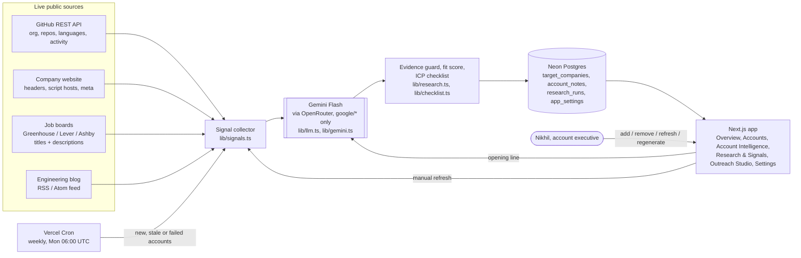

# Components Map: Stack Scout

Stack Scout is a B2B sales-intelligence app for an account executive selling a developer productivity tool. It watches a list of target companies, gathers live public engineering signals, has Gemini Flash write the context and first line, scores ICP fit, and refreshes weekly.

**Live app:** https://tech-stack-scout-topaz.vercel.app · **Repository:** https://github.com/manasvinipant-cloud9/tech-stack-scout

## 1. System diagram

## 2. Components

| Component | Responsibility | Technology | Code |
|---|---|---|---|
| Signal collector | Pulls public engineering signals from four live sources in parallel | fetch, Next.js route handlers | `lib/signals.ts` |
| Job-description reader | Reads up to 15 engineering job posts; counts tool and microservices mentions | Greenhouse / Lever / Ashby public APIs | `lib/signals.ts` |
| Engineering-blog reader | Discovers a feed on common blog locations; reads recent posts and cadence | RSS / Atom parsing | `lib/signals.ts` |
| AI layer | One gateway for all model calls: retries, fallback model, structured JSON. Only Gemini Flash models are used | OpenRouter (`google/gemini-3.8-flash`, fallback `3.7-flash`, Google-only providers) or Gemini API directly | `lib/llm.ts` |
| Gemini analyst | Classifies the stack (confirmed vs inferred, with source), judges architecture, writes fit reasons, open questions, the two-paragraph summary and the first line | Gemini Flash | `lib/gemini.ts` |
| Evidence guard | Any claim citing a source that was not collected is downgraded to "inferred / no source" | TypeScript | `lib/gemini.ts` |
| Fit score | Sum of sourced fit-reason strength (1 to 3) divided by 15; unsourced reasons score 0 | TypeScript | `lib/research.ts` |
| ICP checklist | Cloud, microservices and language checks against configurable targets, each with a verdict and evidence | TypeScript | `lib/checklist.ts` |
| Coverage model | Per-account state for six signals: evidence found, partial, no evidence found, not researched, research failed | TypeScript | `lib/coverage.ts` |
| Action queue and insights | Prioritised next actions, plus changes and new signals computed from stored records | TypeScript | `lib/actions.ts`, `lib/insights.ts` |
| Opening-line generator | Regenerates a first line grounded in one verified signal, stored with its source | Gemini Flash | `lib/outreach.ts` |
| Watchlist store | Companies, cached intelligence, signals, notes, run history, settings | Neon serverless Postgres | `lib/db.ts` |
| Weekly refresh | Re-researches accounts that are new, stale or failed, up to a saved per-run limit; protected by a secret | Vercel Cron | `app/api/cron/refresh`, `vercel.json` |
| Application | Sidebar shell, command palette, bento Overview, filterable Accounts with a quick-view drawer, Account Intelligence dossier, Research & Signals, Outreach Studio, Settings | Next.js App Router, Tailwind v4 | `app/(app)`, `components/` |

## 3. Data model (Neon Postgres)

| Table | Holds |
|---|---|
| `target_companies` | The watchlist: name, domain, GitHub org, status, fit score, stored analysis and signals (JSON), summary, opening line |
| `research_runs` | One row per refresh: status, fit score, previous fit, what changed, error |
| `account_notes` | The user's notes per company, with tags |
| `app_settings` | Saved ICP targets, stale threshold, weekly per-run limit |

## 4. Pages and API routes

| Page | Purpose |
|---|---|
| `/` Overview | Priorities, next actions, fit distribution, signal coverage, cloud and language mix, fit vs hiring, changes, research timeline |
| `/accounts` | Watchlist with search, saved views, filters, sorting, bulk actions, add and remove |
| `/accounts/[id]` | Account Intelligence: summary, ICP fit and evidence, technology map, activity, opening line, methodology |
| `/research` | Coverage matrix, freshness, evidence gaps, refresh queue, run log |
| `/outreach` | Choose a company, inspect observations, generate and copy an opening line |
| `/settings` | Edit ICP and research preferences; read-only integration status |
| `/brief/[id]` | Printable one-page call brief |

| API route | Purpose |
|---|---|
| `POST /api/companies` | Add a company |
| `DELETE /api/companies/[id]` | Remove a company |
| `POST /api/companies/[id]/refresh` | Re-research one company |
| `POST /api/companies/[id]/opening-line` | Regenerate the opening line |
| `GET /api/companies/[id]/preview` | Quick-view data for the Accounts drawer |
| `GET, POST /api/companies/[id]/notes` | Notes |
| `GET, PUT /api/settings` | ICP and research preferences |
| `GET /api/cron/refresh` | Weekly job (requires `CRON_SECRET`) |

## 5. How the brief's requirements are met

| Requirement | Where |
|---|---|
| Live external data | GitHub, website, job boards, engineering blog |
| All AI on Gemini Flash | `lib/llm.ts`: only Gemini Flash models are called |
| Languages, cloud tooling, team activity per company | Account Intelligence, technology map, activity |
| Two-paragraph summary and a non-template first line | `lib/gemini.ts`, `lib/outreach.ts` |
| Relevance in cloud, microservices and language | ICP checklist |
| Refreshed weekly | Vercel Cron, Mondays 06:00 UTC |
| Add and remove companies without touching code | Accounts page dialogs, or the database directly |
| Public URL on Vercel | https://tech-stack-scout-topaz.vercel.app |
