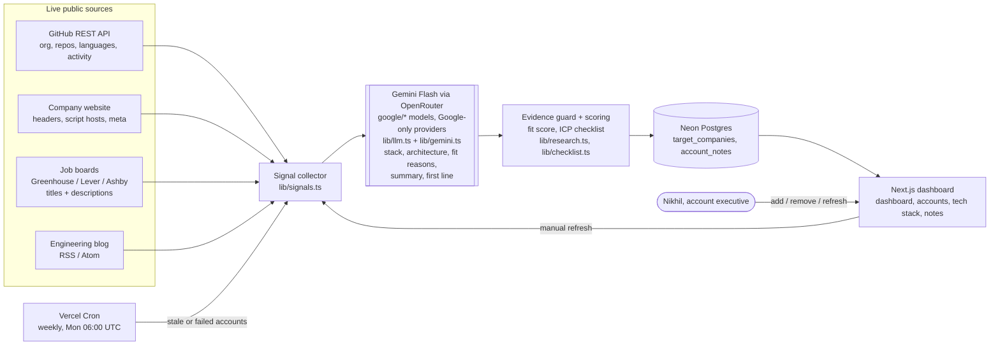

# Components Map: Stack Scout

| Component | Responsibility | Technology | Code |
|---|---|---|---|
| Signal collector | Pulls public engineering signals from four live sources in parallel | fetch, Next.js route handlers | `lib/signals.ts` |
| Job-description reader | Reads up to 15 engineering posts; counts tool and microservices mentions | Greenhouse / Lever / Ashby public APIs | `lib/signals.ts` |
| Engineering-blog reader | Discovers a feed and reads recent posts and cadence | RSS / Atom parsing | `lib/signals.ts` |
| Gemini analyst | Stack classification (confirmed / inferred + source), architecture, fit reasons, open questions, two-paragraph summary, personalised first line | Google Gemini Flash (`google/gemini-3.8-flash`, fallback `3.7-flash`) via OpenRouter restricted to Google providers; direct Gemini API as alternate | `lib/gemini.ts`, `lib/llm.ts` |
| Evidence guard | Claims citing sources we never collected become "inferred / no source" | TypeScript | `lib/gemini.ts` |
| Fit score | Σ strength of sourced fit reasons ÷ 15 | TypeScript | `lib/research.ts` |
| ICP checklist | Cloud, microservices, language checks vs configurable targets | TypeScript, env | `lib/checklist.ts`, `lib/icp.ts` |
| Watchlist store | Companies, cached intelligence, notes | Neon serverless Postgres | `lib/db.ts` |
| Weekly refresh | Re-researches accounts that are new, older than 7 days, or failed | Vercel Cron | `app/api/cron/refresh`, `vercel.json` |
| Dashboard | Priority table, KPIs, signal coverage, states, light and dark themes | Next.js App Router, Tailwind v4 | `app/(app)`, `components/` |

The same map is shown live in the app at `/components-map`.
